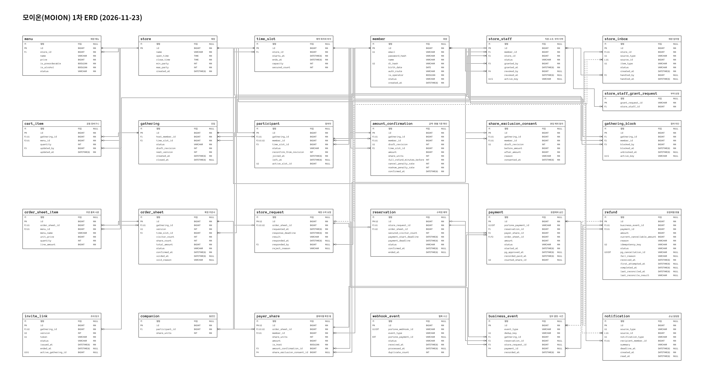

# 모이온(MOION) 1단계 ERD v0.4 (전체 도면 작성·설계 대조 완료, MySQL DDL·동시성 검증 전)
2026-11-23 · 기준: 확정 정책 v30 · 첫 배포 범위와 합격 조건 v0.2 · 개발 컨벤션 v0.1 · 1단계 API 명세 확정안
v0.4: 직원 권한 부여 요청 테이블(store_staff_grant_request) 추가, 25개 테이블

문서 상태: 확정(전체 도면 작성·설계 대조 완료). 구현 상태: MySQL DDL·동시성 검증 전. 본문의 "사례집 n-m"은 [검산 사례](verification-cases.md)의 번호다.

## 전체 도면 (25개 테이블)

- 테이블·컬럼·키·관계 원본(DBML): [erd.dbml](erd.dbml) — [dbdiagram.io](https://dbdiagram.io)에 붙여 넣으면 도면으로 볼 수 있다.
- 도면 원본(SVG, 확대용): [erd/moion-erd-v0.4.svg](erd/moion-erd-v0.4.svg)
- 실선은 물리 FK, 점선은 논리 참조(알림·매장 업무함의 출처)다.
- 25개 테이블: member, store, store_staff, store_staff_grant_request, time_slot, menu, gathering, invite_link, participant, gathering_block, companion, cart_item, amount_confirmation, share_exclusion_consent, order_sheet, order_sheet_item, payer_share, store_request, reservation, payment, webhook_event, business_event, refund, notification, store_inbox

## 1. 확정한 관계

| 관계 | 기준 |
|---|---|
| gathering 1 → N store_request (order_sheet를 거쳐) | 모임 하나에 수락 요청은 여러 번 가능하다. 재요청할 때마다 새 요청을 만들고, 이전 요청의 결과와 당시 주문서를 보존한다 |
| store_request 1 → 0..1 reservation | 거절·요청 취소·응답 만료는 예약 0건. `reservation.store_request_id`는 유일하다. 요청 수락·예약 생성·회차 좌석 확보는 한 트랜잭션이며, 같은 요청을 다시 처리해도 예약과 좌석이 늘지 않는다 |
| payment → payer_share | 결제를 시작할 때 당시 주문서의 결제자별 몫에 연결한다. 결제가 어느 예약의 돈인지도 하나로 특정된다. 늦은 웹훅을 처리할 때 모임의 최신 주문서를 찾아 금액을 적용하지 않는다 |

같은 모임에서 응답 대기 요청이나 진행 중 예약이 동시에 둘 살아 있을 수 없다. 요청을 만들 때 같은 모임의 응답 대기 요청과 진행 중 예약을 함께 검사한다. 조기 종료된 이전 예약의 환불 진행 중 상태는 새 요청을 막지 않는다. `reservation.store_request_id` 유일 키만으로는 이 경우를 막을 수 없으므로, 검사 방식은 잠금 설계에서 함께 정한다.

## 2. 상태의 주인

| 테이블 | 한 행의 뜻 | 관리하는 상태 |
|---|---|---|
| gathering | 참여자들이 함께 메뉴를 정하는 모임 하나. 조기 종료 뒤 다시 요청해도 같은 모임 | 모임 자체의 진행(메뉴 편집 등). 결제 상태는 따로 갱신하지 않는다 |
| store_request | 매장에 보낸 요청 한 번. 확보 좌석 0석 | 매장 응답 결과(응답 대기·수락·거절·요청 취소·응답 만료) |
| reservation | 매장이 수락해 좌석을 확보하고 결제 마감이 생긴 예약 한 건 | 결제 대기·확정·만료·조기 종료. 해당 예약의 주문서·결제·환불을 끝까지 추적 |

손님에게 보이는 모임의 진행 단계는 store_request와 reservation 기록을 기준으로 보여 준다.

## 3. 1단계 테이블 (25개)

- 회원·권한: member, store, store_staff, store_staff_grant_request
- 회차·메뉴: time_slot, menu
- 모임: gathering, invite_link, participant, gathering_block, companion, cart_item
- 확인 기록: amount_confirmation, share_exclusion_consent
- 주문서·요청: order_sheet, order_sheet_item, payer_share, store_request
- 예약·결제: reservation, payment, webhook_event
- 환불·알림: business_event, refund, notification, store_inbox

1단계 제외: 방문 코드, 현장 접수, 이의, 정정, 매장 지급 기록(2·3단계).

## 4. 첫 묶음 컬럼·제약 (주문서 → 매장 요청 → 예약 → 결제)

| 테이블 | 컬럼 | 유일 키·제약 |
|---|---|---|
| order_sheet | id, gathering_id, version, time_slot_id(확정 당시 회차), visitor_count, share_count, total_amount, status(유효/무효), confirmed_at, voided_at, void_reason | UK(gathering_id, version) |
| payer_share | id, order_sheet_id, member_id, share_units, amount, is_host, amount_confirmation_id(8-3), share_exclusion_consent_id(10-1) | UK(order_sheet_id, member_id), UK(id, order_sheet_id) |
| store_request | id, order_sheet_id, requested_at, response_deadline, result(PENDING/ACCEPTED/REJECTED/CANCELED_BY_HOST/EXPIRED), responded_at, responded_by, reject_reason | UK(order_sheet_id), UK(id, order_sheet_id) |
| reservation | id, store_request_id, order_sheet_id, secured_visitor_count(수락 때 실제 확보한 좌석 수), payment_start_deadline, payment_deadline, status(결제 대기/확정/만료/조기 종료), confirmed_at, ended_at | UK(store_request_id), UK(id, order_sheet_id) |
| payment | id, portone_payment_id, reservation_id, payer_share_id, order_sheet_id, amount, status, started_at, pg_approved_at, recorded_paid_at, counted_share_id(10-7) | UK(portone_payment_id), UK(counted_share_id) |

모임과 회차는 중복 컬럼으로 두지 않고 당시 주문서(order_sheet.gathering_id, order_sheet.time_slot_id)를 통해 조회한다. 중복 컬럼을 두면 OS1 주문서의 요청에 다른 모임 ID를 쓰거나, 예약 만료 때 엉뚱한 회차의 좌석을 푸는 오류를 세 복합 FK로도 막지 못한다.

### 4-1. 주문서 소속을 묶는 FK

기본 FK: store_request.order_sheet_id → order_sheet.id, payer_share.order_sheet_id → order_sheet.id. UNIQUE(order_sheet_id)만으로는 해당 주문서가 존재한다는 보장이 없다.

복합 FK:

| 자식의 복합 FK | 부모의 참조 키 | 막는 오류 |
|---|---|---|
| reservation(store_request_id, order_sheet_id) | store_request(id, order_sheet_id) | OS1 요청에서 OS2 예약 생성 |
| payment(reservation_id, order_sheet_id) | reservation(id, order_sheet_id) | OS1 예약에 OS2 결제 연결 |
| payment(payer_share_id, order_sheet_id) | payer_share(id, order_sheet_id) | OS1 결제에 OS2 결제자 몫 연결 |

- 각 부모에는 표와 같은 컬럼 순서의 UNIQUE 키를 둔다.
- 자식의 참조 컬럼은 모두 NOT NULL이다. MySQL에서는 복합 FK의 일부가 NULL이면 일치하는 부모가 없어도 행이 들어갈 수 있다.
- 자식 쪽에도 FK 검사에 맞는 인덱스를 둔다.

### 4-2. 설계 규칙
- 새 주문서 버전: 요청이 거절·취소·응답 만료되거나, 수락 후 예약이 조기 종료된 뒤 새로 수락을 요청할 때는 새 주문서 버전을 사용한다. 응답이 끊겨 같은 요청을 재시도하면 기존 요청 결과를 돌려준다. 이 규칙이 UK(store_request.order_sheet_id)의 근거다. POL-001·상태 전이표는 이전 주문서 보존과 새 결제 사용 금지를 정하며, 이 규칙은 1단계 ERD에서 정한 설계 선택이다.
- 전원 결제 판정: 해당 예약의 결제 예정 몫(payer_share) 각각에 금액이 일치하고 기한 내 반영된 성공 결제가 있는가로 판정한다. 성공 결제 수로 세지 않는다. 같은 몫에 성공 결제가 둘 있어도 결제자는 한 명이며, 중복 승인된 돈은 별도로 추적한다. 동시 반영을 막는 잠금 방식은 다음 묶음에서 정한다.
- 서비스 검사: FK는 주문서 소속만 보장한다. 결제 시작 때 로그인 사용자와 payer_share.member_id를 대조하고, 결제 반영 때 PG 승인액과 확정 금액을 대조한다.
- 시각: pg_approved_at은 PG 승인 시각(대조용), recorded_paid_at은 모이온 서버가 처음 유효하게 반영한 시각이다. recorded_paid_at은 최초 값을 보존해 뒤늦은 중복 웹훅이 마감 판정을 바꾸지 않게 한다.

### 4-3. 첫 묶음 합격 기준
- 다른 주문서끼리 연결하면 DB가 거부한다(4-1의 세 경우).
- 올바르게 연결된 옛 결제가 늦게 도착하면 옛 예약에서만 20,000원을 환불하고, 새 예약의 A 몫 18,000원과 결제 완료 인원은 바뀌지 않는다(사례집 9-6).
- 현재 상태: 설계 검산 완료. MySQL 통합 테스트로 두 결과를 재현하면 구현 검증 완료.

## 5. 잠금 기준 (다음 묶음의 출발점)

| 경합 | 기준으로 삼을 행 | 통합 테스트에서 볼 결과 |
|---|---|---|
| 같은 모임에서 동시에 수락 요청 생성 | gathering 한 행. 잠금을 얻은 뒤 현재 요청·예약을 다시 확인 | 같은 주문서의 재시도면 기존 요청 반환. 서로 다른 주문서로 동시에 요청해도 살아 있는 요청은 1건 |
| 서로 다른 모임이 마지막 좌석을 동시에 확보 | time_slot 한 행. 같은 회차의 좌석 확보·해제는 모두 이 행 기준 | 20석 중 14석 확보 상태에서 6명 모임 둘이 경합하면 정확히 하나만 수락, 최종 확보 20석 |
| 마지막 결제 반영과 예약 만료 | 결제 반영은 gathering → reservation, 만료는 gathering → time_slot → reservation(5-1). 두 작업이 같은 예약 행에서 최신 기록으로 판정 | 마지막 유효 완료 기록이 마감 전이면 확정 1건, 같거나 늦으면 만료. 늦게 확인된 승인액도 환불 대상으로 추적 |
| 같은 결제자 몫에 성공 통보 두 건 | 1단계는 결제 반영 경로의 gathering → reservation 잠금을 재사용 | 같은 PG 결제 ID 재통보는 한 번만 반영. 서로 다른 PG 결제 ID가 둘 다 승인되면 두 원결제 기록 보존, 해당 몫 완료 인원은 1명 |

- "무슨 행을 잠그는가"와 "여러 행을 어떤 순서로 잠그는가"는 따로 적는다. 두 행 이상을 함께 갱신하는 경로(수락·만료·조기 종료)는 모두 같은 순서를 따른다.
- PG 조회·취소 호출은 잠금 밖에서 수행한다.
- 별도 잠금 테이블은 두지 않는다.

### 5-1. 공통 잠금 순서 (확정)
**gathering → time_slot → reservation.** 각 작업은 필요한 행만 잠그고, 둘 이상이 필요하면 이 순서를 지킨다. 역순으로 잠그는 경로를 만들지 않는다.

| 작업 | 잠금과 처리 순서 |
|---|---|
| 매장 수락 | gathering → time_slot. 요청이 여전히 응답 대기인지, 기한 안인지, 자리가 충분한지 다시 확인한다. 요청 수락·좌석 확보·새 reservation 생성을 한 번에 커밋한다. 같은 수락 요청의 재시도에는 기존 예약을 돌려준다 |
| 결제 기한 만료 | 배치는 만료 후보 ID만 잠금 없이 조회한다. 예약별 트랜잭션에서 gathering → time_slot → reservation 순으로 잠그고, 결제 대기 상태와 전원의 완료 기록을 다시 확인한다. 만료 조건이 성립할 때만 좌석 해제·환불 접수·필수 알림을 함께 저장한다 |
| 예약자 조기 종료 | gathering → time_slot → reservation. 마지막 결제와 겹치면 서버 기록 시각으로 판정하고, 같으면 조기 종료다(POL-002). 조기 종료가 성립할 때만 좌석을 해제하고 모임을 메뉴 편집으로 돌린다 |
| 결제 반영 | gathering → reservation. 예약 확정 사건(business_event)을 같은 트랜잭션에 기록하면 FK 검사가 부모 gathering에 공유 잠금을 걸 수 있으므로, 결제 반영도 gathering부터 잡는다. 좌석을 바꾸지 않으므로 time_slot은 잡지 않는다. 좌석 해제가 필요해지면 공통 순서를 따르는 만료 경로로 처리한다 |

- 금지 예: 만료 배치가 reservation을 `FOR UPDATE`로 먼저 잡은 채 time_slot을 기다리면 조기 종료와 서로 기다리는 교착이 생길 수 있고, InnoDB 기본 설정에서는 한 트랜잭션이 롤백된다. 후보 조회와 실제 만료 판정을 분리하는 이유다.
- 트랜잭션은 짧게 두고, PG 호출은 커밋 뒤에 한다.
- 앱에서 명시적으로 건 잠금만 세지 않는다. InnoDB는 자식 행을 넣을 때 FK 검사를 위해 부모 행에 공유 잠금을 건다(문서상 가능성, 교착 실측 전).
- 통합 테스트: 마지막 결제와 만료를 동시에 보내고 최종 예약 상태·좌석 수·환불 수·알림 수를 함께 읽는다.

합격 기준(MySQL 통합 테스트로 검증)
- 마지막 6석에 6명 모임 둘이 경합하면 정확히 하나만 수락된다(사례집 8-5).
- 같은 예약에 만료와 조기 종료가 경합하면 좌석은 한 번만 풀린다.

## 5-2. gathering·time_slot 컬럼 (확정)

| 테이블 | 컬럼 | 제약 |
|---|---|---|
| time_slot | id, store_id, starts_at, ends_at, capacity, secured_count | capacity·secured_count NOT NULL, secured_count 기본값 0, CHECK (secured_count >= 0 AND secured_count <= capacity). 1건당 인원 범위는 store로 옮김(8장) |
| gathering | id, host_member_id, time_slot_id(편집 중 선택한 회차), status, draft_revision, next_version, created_at, closed_at | status: EDITING / EDIT_LOCKED / CLOSED. draft_revision은 메뉴·인원·동반인·회차가 바뀔 때마다 1 증가(8-3) |

time_slot.secured_count
- 해당 회차의 결제 대기·확정 예약이 확보한 방문 인원의 합이다. 0몫 동반인도 좌석을 차지하므로 포함한다.
- MySQL의 CHECK는 식이 NULL이면 통과할 수 있으므로 NOT NULL을 함께 둔다.
- 좌석 해제는 예약이 실제로 만료·조기 종료로 전이된 트랜잭션에서 한 번만 수행한다. 두 번 차감해 8석이 되어도 CHECK는 통과하므로 제약만으로는 막지 못한다. 전원 결제로 확정될 때는 이미 확보한 좌석을 그대로 유지한다.
- 합격 기준: 14 → 20 → 20 → 14 → 14 (14석 회차에서 6명 예약 수락, 같은 수락 재시도, 결제 기한 만료, 만료 재실행). 사례집 8-7.

gathering.status (편집을 다시 열 수 있는지만 나타낸다)

| 상태값 | 의미와 전이 |
|---|---|
| EDITING | 메뉴·참여 구성을 편집할 수 있다. 매장 거절, 예약자의 수락 요청 취소, 매장 응답 기한 만료, 예약자의 결제 대기 조기 종료 때 돌아온다 |
| EDIT_LOCKED | 메뉴 확정 시 편집을 닫는다. 매장 응답 대기·결제 대기·예약 확정의 상세 단계는 store_request와 reservation에서 읽는다 |
| CLOSED | 모임을 다시 열 수 없다. 결제 기한 만료, 예약자 이탈, 예약 전체 취소, 매장 사정 취소로 모임이 끝난 경우(POL-003 v29 집계 제외 사유와 같음). 종료 사유는 해당 요청·예약 기록으로 구분한다 |

결제 기한 만료 시 CLOSED는 확정 정책 v28 POL-002 결정이다(2026-11-23). 검산: 사례집 8-8.

- 상태값에 "진행 중"을 쓰지 않는다. POL-003의 "진행 중 모임"은 메뉴 편집 중인 모임까지 포함하므로, 같은 말을 상태값으로 쓰면 중복 참여 검사에서 편집 중 모임을 빠뜨릴 수 있다.

## 6. ERD 그림 표기 (확정)
- 흰 바탕, 검은 글자, 직각 테두리, 직각 연결선. 까마귀발 표기(┼┼ 정확히 1, ○┤ 0 또는 1, ○< 0 이상).
- 컬럼 줄: 키(PK·FK·UK와 번호) · 컬럼명(snake_case) · 타입 · NULL 허용.
- FK·UK 번호는 각 테이블 안에서만 유효하다(reservation의 FK1과 payment의 FK1은 서로 다른 제약).
- 자식 쪽 FK로 보장되지 않는 업무 조건은 그림에 짧게 적는다(예: 확정 주문서에는 결제자 몫 1건 이상).
- 컬럼 미확정 테이블은 점선 박스.
- 전체판: 컬럼과 키가 모두 정해진 뒤 25개 테이블을 한 장으로 그린다. 주문서 → 매장 요청 → 예약 → 결제 → 환불을 중심에, 회원·매장·회차는 위에, 참여·분담·알림은 관련 테이블 가까이 둔다. store_request.responded_by·store_inbox.handled_by는 store_staff.id로 연결한다(10-3). 다형 참조는 점선 "논리 참조", webhook_event.portone_payment_id는 외부 값으로 구별 표시한다(10-5). 최종본은 SVG(확대용)로 남긴다.
- 첫 묶음 시안(moion_erd_bundle1)은 사례 9-6 설명용으로 따로 보존한다.

## 8. 나머지 18개 테이블 컬럼·키 (확정)

표기: PK·FK·UK, NN = NOT NULL. 시각은 DATETIME(6), 금액은 BIGINT(원).

### 8-0. 공통 기법: 살아 있는 행만 유일
MySQL에는 조건부 유일 인덱스가 없으므로, 유효할 때만 값이 있고 끝나면 NULL인 `active_*` 열에 UK를 건다(UK는 NULL을 여러 개 허용). 활성 행인데 실수로 NULL을 넣어도 UK는 통과하므로 다음처럼 묶는다.
- 행 하나만 보고 활성 여부를 알 수 있는 곳(store_staff, invite_link, gathering_block): 상태에서 계산하는 생성 열로 둔다. 예: `active_key VARCHAR GENERATED ALWAYS AS (CASE WHEN status = 'ACTIVE' THEN CONCAT(member_id, ':', store_id) END) STORED`
- 모임 종료까지 봐야 하는 곳(participant): 8-4 전이표와 같은 트랜잭션에서 갱신한다.
- InnoDB는 유일 키 중복을 검사할 때도 잠금을 쓰므로, 별도 회원 행을 먼저 잠글 필요가 없다.

### 8-1. 회원·권한

| 테이블 | 컬럼 | 키·제약 |
|---|---|---|
| member | id, email, password_hash, name, di_hash, birth_date, auth_route(TEST_CHANNEL/MOCK/REAL), is_operator, status(ACTIVE/WITHDRAWN), created_at | UK email, UK di_hash, NN 전부. 본인인증 성공 뒤에만 생성(POL-004 v30). di 원문 대신 키 있는 해시. is_operator는 초기 데이터로만 설정 |
| store | id, name, open_time, close_time, min_party, max_party, created_at | min_party·max_party NN, CHECK (min_party >= 1 AND max_party >= min_party) |
| store_staff | id, member_id, store_id, status(ACTIVE/REVOKED), granted_by, granted_at, revoked_by, revoked_at, active_key(생성 열) | UK(active_key). 부여·회수 이력은 행으로 남김(재부여 시 새 행) |
| store_staff_grant_request | grant_request_id, store_staff_id | PK grant_request_id(운영 화면이 부여 동작마다 만드는 UUID). store_staff_id NN FK → store_staff.id, UNIQUE 없음 |

로그인: 이메일 + 비밀번호, Spring Security 세션.
인원 검사: 참여할 때는 0몫 동반인을 포함한 최대 인원(store.max_party), 매장 수락 때는 1건당 인원 범위와 해당 회차 남은 좌석을 모두 확인한다.

store_staff_grant_request (직원 권한 부여 재시도)
- 성공한 부여 요청 ID마다 처리한 부여 이력(store_staff)을 연결해 남긴다. 한 부여 이력에 요청 ID 여러 개가 연결될 수 있으므로 store_staff_id에는 UNIQUE를 걸지 않는다.
- 같은 요청 ID가 다시 오면 운영자 자격을 확인한 뒤 연결된 이력과 대상 회원·매장을 대조한다. 같으면 그 이력의 현재 상태를 200으로 돌려주고, 다르면 409 GRANT_REQUEST_CONFLICT.
- 새 권한 생성(또는 이미 활성인 권한 반환)과 요청 연결 저장은 한 트랜잭션이다. 권한이 회수돼도 연결은 지우지 않는다.
- 회수 뒤 재부여는 새 요청 ID로만 한다.
- 동시 부여: 같은 회원·매장에 서로 다른 요청 A·B가 동시에 오면 권한을 만든 쪽은 201, 이미 만들어진 부여 이력에 자기 요청 ID를 연결한 쪽은 200이다. 두 응답의 storeStaffId는 같다. 요청 ID와 부여 이력의 연결이 커밋된 뒤에만 성공을 반환한다.
- 구현 기준: 활성 권한 유일 키(active_key) 충돌이 나면 실패한 트랜잭션은 롤백한다. 새 트랜잭션에서 그 요청 ID의 기존 연결을 먼저 조회하고, 연결이 없으면 같은 회원·매장의 활성 이력을 확인해 연결을 저장한 뒤 200을 반환한다. DB 충돌을 만났다는 이유만으로 저장되지 않은 요청에 200을 주지 않는다.
- 검산: 요청 A로 부여 이력 61 생성(201) → 다른 요청 B가 이미 활성인 61을 돌려받음(200, A·B 모두 61에 연결) → 61 회수 → B 재전송: 200 / 61 / REVOKED, 활성 권한 0건, 새 부여 이력 0건.
- 동시성 테스트 기대 결과
  - 권한이 없는 상태에서 같은 회원·매장에 A·B 동시 요청 → 201 1건, 200 1건. 활성 권한 1건, A·B 모두 같은 이력 61에 연결
  - 61 회수 뒤 B 재전송 → 200, storeStaffId 61, status REVOKED. 활성 권한 0건
  - B를 다른 회원이나 다른 매장에 재사용 → 409 GRANT_REQUEST_CONFLICT. 기존 연결과 권한은 그대로

### 8-2. 메뉴·모임 구성

| 테이블 | 컬럼 | 키·제약 |
|---|---|---|
| menu | id, store_id, name, price, is_preorderable, is_alcohol, status | CHECK NOT(is_preorderable AND is_alcohol) |
| invite_link | id, gathering_id, version, token, status(VALID/REISSUED/REVOKED/CLOSED_BY_CONFIRM), issued_at, ended_at, active_gathering_id(생성 열) | UK token, UK(gathering_id, version), UK(active_gathering_id) |
| participant | id, gathering_id, member_id, time_slot_id, status(JOINED/LEFT/KICKED), reconfirm_from_revision, joined_at, left_at, active_slot_id | UK(gathering_id, member_id), UK(member_id, active_slot_id) |
| gathering_block | id, gathering_id, member_id, blocked_by, blocked_at, unblocked_at, active_key(생성 열) | UK(active_key) |
| companion | id, participant_id, share_units | CHECK share_units IN (0, 1). 개인정보 저장 안 함 |
| cart_item | id, gathering_id, menu_id, quantity, updated_by, updated_at | UK(gathering_id, menu_id), CHECK quantity > 0 |
| order_sheet_item | id, order_sheet_id, menu_id, menu_name, unit_price, quantity, line_amount | UK(order_sheet_id, menu_id), CHECK line_amount = unit_price × quantity |

- invite_link: 현재 참여자가 같은 유효 링크를 다시 조회해야 하므로 토큰을 원문 저장한다(POL-016에서 해시만 저장은 검토 후 제외). 링크 값은 로그에 남기지 않는다. 메뉴 확정으로 닫힌 링크는 거절 후 편집에 복귀해도 되살리지 않는다(검증 대상).
- order_sheet_item: 메뉴 확정 때 품목명·당시 단가·수량을 보존해 메뉴 가격이 바뀌어도 옛 주문서를 재현한다. 확정 트랜잭션에서 Σ 품목 금액 = 주문서 총액 = Σ 결제자별 금액을 검사한다.

### 8-3. 확인 기록 (누구에게 다시 받을지)

| 테이블 | 컬럼 | 키·제약 |
|---|---|---|
| amount_confirmation | id, gathering_id, member_id, draft_revision, time_slot_id, amount, share_units, full_refund_minutes_before, cancel_penalty_rate, noshow_penalty_rate, confirmed_at | UK(gathering_id, member_id, draft_revision) |
| share_exclusion_consent | id, gathering_id, member_id, draft_revision, before_amount, after_amount, reason, consented_at | UK(gathering_id, member_id, draft_revision) |

- gathering.draft_revision은 오래 열린 화면에서 이전 분담안을 확정하는 일을 막는 데 쓴다. 버전이 올랐다는 이유만으로 전원의 확인을 해제하지 않는다.
- participant.reconfirm_from_revision = 이 사람이 마지막으로 재확인을 요구받은 버전. 본인 금액이 바뀌면 그 사람만, 회차가 바뀌면 전원을 현재 draft_revision으로 올린다. 차단 해제·나간 뒤 재참여한 사람도 올린다.
- 유효한 확인 = amount_confirmation.draft_revision ≥ participant.reconfirm_from_revision 이고 time_slot_id가 모임의 현재 회차와 같은 행. 19시 → 20시 → 19시로 회차를 되돌려도 예전 19시 확인은 살아나지 않는다.
- 분담 제외 동의는 최종 분담안에서 부담이 늘어난 사람의 기록을 별도로 확인한다(POL-001).
- 환불 기준은 비율 하나로는 "1시간 전까지 전액 환불" 같은 시간 조건이 복원되지 않으므로, 확인 당시 기준을 불변 사본(full_refund_minutes_before 60, cancel_penalty_rate 15, noshow_penalty_rate 20)으로 저장한다.
- 주문서 확정 시 payer_share에 amount_confirmation_id(FK)를 연결해 각 결제자가 실제로 확인한 기록을 추적한다.

### 8-4. participant.active_slot_id 전이

| 발생한 일 | active_slot_id 처리 |
|---|---|
| 예약자가 모임 생성 / 참여자 신규 참여 | 예약자 자신을 포함해 현재 회차 ID 기록 |
| 매장 거절 / 수락 요청 철회 / 60분 응답 만료 / 예약자 조기 종료 | 유지. 같은 모임이 메뉴 편집으로 돌아가므로 계속 집계 |
| 개인이 나감 / 내보내기 | 해당 사람만 NULL. 재참여가 허용되면 UK(gathering_id, member_id)에 맞춰 기존 행을 다시 활성화하고 이전 확인을 초기화(reconfirm_from_revision 갱신) |
| 결제 기한 만료 / 예약자 이탈 / 예약 전체 취소 / 매장 사정 취소로 모임 종료 | 종료 트랜잭션에서 전원 NULL. 환불 처리 중에도 같은 회차 다른 모임 참여 가능 |
| 회차 변경 | 참여 중인 전원의 회차를 한 트랜잭션에서 이동. 한 명이라도 UK 충돌이면 회차·참여·재확인 변경을 전부 롤백 |

### 8-5. 결제·이벤트·환불·알림

| 테이블 | 컬럼 | 키·제약 |
|---|---|---|
| webhook_event | id, portone_webhook_id, event_type, portone_payment_id, status(RECEIVED/APPLIED/IGNORED/REJECTED), received_at, processed_at, duplicate_count | UK(portone_webhook_id) |
| business_event | id, event_type, dedup_key, gathering_id, reservation_id, store_request_id, payment_id, recorded_at | UK(dedup_key). gathering_id 외 FK는 NULL 허용 |
| refund | id, business_event_id, payment_id, amount, current_cancellable_amount, reason, idempotency_key, status(RECEIVED/REQUESTED/COMPLETED/FAILED/HOLD), pg_cancellation_id, fail_reason, received_at, first_attempted_at, completed_at, last_reconciled_at, last_reconcile_result | UK(business_event_id, payment_id), UK(idempotency_key), UK(pg_cancellation_id), CHECK amount > 0 |
| notification | id, source_type(EVENT/REFUND), source_id, notification_type, recipient_member_id, summary, deadline_at, created_at, read_at | UK(source_type, source_id, notification_type, recipient_member_id) |
| store_inbox | id, store_id, source_type(STORE_REQUEST/EVENT), source_id, item_type, status(OPEN/DONE/EXPIRED), created_at, handled_by, handled_at | UK(store_id, source_type, source_id, item_type) |

- webhook_event: 수신 기록과 업무 반영을 나눠 커밋하므로 RECEIVED를 둔다. 같은 ID가 다시 오면 미처리(RECEIVED)는 재개하고, 완료된 건은 기존 결과를 유지한 채 duplicate_count만 올린다. 첫 APPLIED를 IGNORED로 덮어쓰지 않는다. 서명 검증 실패 건은 저장하지 않는다.
- business_event: 메뉴 확정 전 확인 요청처럼 예약·요청·결제가 없는 사건도 gathering_id와 재시도해도 같은 키로 찾는다. dedup_key 예: `CONFIRM_REQUESTED:{gatheringId}:{draftRevision}`, `RESERVATION_EXPIRED:{reservationId}`.
- refund: received_at(모이온이 환불을 접수한 시각)과 first_attempted_at(PG 전송을 처음 시도한 시각)을 구분한다. 첫 시도 시각·키·요청 내용을 저장하고 커밋한 뒤 PG를 호출한다. 이 시각만으로 PG 도달 여부를 단정하지 않는다. 응답이 유실되면 PG와 대조하고, 처리 중이거나 결과가 불명인 금액도 원결제별 누적 환불 한도에 포함한다. PortOne 멱등 보장 기간(공식 문서상 3시간, 변경 가능)이 지난 불명 건은 성공 내역이 안 보인다는 이유만으로 재전송하지 않고 HOLD로 운영 확인에 넘긴다.
- store_inbox: "매장당 사건 1건"을 UK(store_id, source_type, source_id, item_type)로 표현한다. 요청 만료 시 새 항목 대신 기존 항목을 EXPIRED로 바꾼다(사례집 11-8).

### 8-6. 검산 (설계 검산 완료, SQL 실행 전)
- 사례집 11-1: 환불 r1(16,000원)·r2(4,000원) 각각 접수·완료 → source가 REFUND:r1, REFUND:r2로 달라 고객 알림 4건.
- 사례집 11-2: 만료 6건 + 환불 접수 4 + 완료 4 = 고객 알림 14건. 매장 업무함 만료 결과 1건은 별도. 만료 재실행은 dedup_key UK로 추가 0건.
- 사례집 8-4: 마지막 한 자리 동시 참여는 gathering 행 잠금 뒤 방문 인원 ≤ store.max_party 검사로 한 명만 성공.

### 8-7. 이번 묶음의 MySQL 통합 테스트 네 장면
1. 같은 회원이 같은 회차 두 모임에 동시 참여 → 정확히 한 건 성공
2. 회차 이동 중 한 명이 UK 충돌 → 회차·참여·재확인 전원 원상태
3. 30분 결제 만료 뒤 환불 진행 중 → 같은 회차 새 모임 참여 성공(사례집 8-8)
4. 조기 종료 뒤 → 같은 회차 다른 모임 참여 거부(사례집 8-9)

3과 4가 서로 반대 결과를 내야 이 ERD가 POL-002·003을 제대로 표현한 것이다.

## 10. 관계 보완 (2차 검토 반영)

실제 키 검사(SQLite 재현, MySQL DDL·InnoDB 동시성은 검증 전): 4-1의 복합 FK는 다른 주문서끼리의 연결을 거부했다. 반면 아래 ①②는 자식이 가리키는 부모가 각각 존재해도 두 부모가 같은 업무에 속하는지를 단순 FK가 검사하지 않아 DB가 허용했다.

### 10-1. 결제자 몫 ↔ 금액 확인·분담 제외 동의
- payer_share.amount_confirmation_id: NOT NULL FK.
- payer_share.share_exclusion_consent_id: NULL 허용 FK. 제외 동의가 필요했던 몫은 실제 사용한 동의 ID를 보존해 이후 편집과 구별한다.
- amount_confirmation(gathering_id, member_id), share_exclusion_consent(gathering_id, member_id) → participant(gathering_id, member_id) 복합 FK.
- 주문서 확정 트랜잭션에서 모임·회원·회차·금액·몫·유효한 재확인 버전(8-3)을 함께 대조한다. 다른 모임의 같은 20,000원 확인은 근거가 될 수 없다.

### 10-2. 환불 ↔ 업무 사건 ↔ 원결제
- 만료·조기 종료·예약자 이탈 환불은 종료한 예약에서 원결제 목록을 조회해 생성한다. 외부에서 받은 결제 ID로 만들지 않는다.
- 저장할 때 business_event.reservation_id = payment.reservation_id를 검사한다. 늦게 도착한 승인도 원래 예약의 종료 결정에 연결한다.
- 합격 조건: R1 만료 결정과 R2 원결제를 넘기면 환불 접수·알림·PG 호출 모두 0건.

### 10-3. 매장 응답·업무함 ↔ 처리 직원
- store_request.responded_by → store_staff.id (NULL 허용). 회수·재부여 뒤에도 당시 어느 매장 권한으로 처리했는지 남는다.
- store_request.result: PENDING / ACCEPTED / REJECTED / CANCELED_BY_HOST / EXPIRED. 응답 만료는 responded_by NULL, 예약자의 요청 철회는 CANCELED_BY_HOST(직원 없음).
- store_inbox.handled_by → store_staff.id (NULL 허용). 실제 처리 시 소속 매장·현재 권한·자기 예약 여부를 검사한다(POL-016).

### 10-4. 예약자 이탈 ↔ 모임·예약 종료
- business_event.event_type에 HOST_LEFT를 둔다. gathering_id와 recorded_at을 남기고, 결제 대기 중이었다면 reservation_id도 남겨 예약 종료와 환불의 근거로 쓴다. 메뉴 편집 중 이탈은 요청·예약 없이 이 사건만 남는다.
- 결제 대기에서 예약자 조기 종료(EARLY_CLOSED → 모임 EDITING)와 예약자 이탈(HOST_LEFT → 모임 CLOSED)은 둘 다 좌석을 풀지만 모임 결과가 다르다.
- 마지막 결제와의 경합 비교 시각: payment.recorded_paid_at vs 해당 business_event.recorded_at(EARLY_CLOSED 또는 HOST_LEFT). 같으면 조기 종료·이탈이 우선(POL-002·007). reservation.ended_at은 같은 값으로 기록한다.

### 10-5. 다형 참조(논리 참조)
- notification.source_id(business_event 또는 refund), store_inbox.source_id(store_request 또는 business_event)는 컬럼 하나에 부모가 둘이라 일반 FK가 없다. 도면에는 점선 "논리 참조"로 표시하고, 생성할 때 출처 존재 여부와 수신자·매장 일치를 확인한다.
- webhook_event.portone_payment_id는 외부 결제 식별자로 대조하는 값이며 물리 FK가 아니다(도면에서 구별 표시).

### 10-6. 모임·참여자·메뉴 ↔ 매장·회차
- cart_item·order_sheet_item의 메뉴 매장 = 선택 회차의 매장을 대조한다.
- 주문서가 참조한 회차는 시작·종료 시각을 고정한다. 시간 변경은 새 회차로 처리한다.
- 모임 생성 트랜잭션에서 예약자를 participant로 함께 넣는다.
- 인원 검사(0몫 동반인 포함): 참여 때 store.max_party, 수락 요청 접수 때 1건당 범위(min_party~max_party, POL-002), 매장 수락 때 실제 남은 좌석.

### 10-7. 같은 몫의 중복 승인
- payment.counted_share_id: 예약 반영으로 인정할 때 payer_share_id를 한 번 기록하고 이후 바꾸지 않는 일반 열 + UK. 상태에서 계산하는 생성 열로 두면 환불로 상태가 바뀔 때 어느 결제를 몫에 반영했는지가 사라지므로 쓰지 않는다. 몫 하나에 반영 인정 결제는 최대 1건.
- 서로 다른 PG 결제가 같은 몫에 둘 다 승인되면 먼저 유효 반영된 1건을 인정하고, 나머지는 DUPLICATE_APPROVAL 사건으로 전액 환불한다.
- 두 결제가 같은 예약이므로 10-2의 "같은 예약인가" 검사만으로는 부족하다. DUPLICATE_APPROVAL 환불은 business_event.payment_id = refund.payment_id까지 일치해야 한다.
- 합격 조건(사례집 9-9): A·B 두 결제가 같은 몫에 각 20,000원 승인 → 결제 완료 인원 1명, 먼저 접수되는 환불은 중복분 B 20,000원 → 다른 참여자 미결제로 만료 → A만 추가 환불. 최종 A·B 각 20,000원, 총 40,000원, 재실행 시 추가 환불 0건.

### 10-8. 관계 다중도와 FK·NULL 일람

| 자식.컬럼 | 부모 | NULL | 다중도(부모 1 : 자식) |
|---|---|---|---|
| store_staff.member_id / store_id | member / store | NN / NN | 1 : 0..N |
| store_staff.granted_by, revoked_by | member | NN / NULL | 1 : 0..N |
| store_staff_grant_request.store_staff_id | store_staff | NN | 1 : 0..N (한 부여 이력에 요청 ID 여러 개, UNIQUE 없음) |
| time_slot.store_id | store | NN | 1 : 0..N |
| menu.store_id | store | NN | 1 : 0..N |
| gathering.host_member_id / time_slot_id | member / time_slot | NN / NN | 1 : 0..N |
| invite_link.gathering_id | gathering | NN | 1 : 0..N (모임 생성 트랜잭션이 최초 링크 1건을 보장) |
| participant.gathering_id | gathering | NN | 1 : 0..N (모임 생성 트랜잭션이 예약자 참여 1건을 보장) |
| participant.member_id | member | NN | 1 : 0..N |
| participant.time_slot_id | time_slot | NN | 1 : 0..N |
| gathering_block.gathering_id / member_id / blocked_by | gathering / member / member | NN | 1 : 0..N |
| companion.participant_id | participant | NN | 1 : 0..N |
| cart_item.gathering_id / menu_id / updated_by | gathering / menu / member | NN | 1 : 0..N |
| amount_confirmation(gathering_id, member_id) | participant | NN | 1 : 0..N |
| amount_confirmation.time_slot_id | time_slot | NN | 1 : 0..N (확인 당시 회차) |
| share_exclusion_consent(gathering_id, member_id) | participant | NN | 1 : 0..N |
| order_sheet.gathering_id / time_slot_id | gathering / time_slot | NN | 1 : 0..N |
| order_sheet_item.order_sheet_id | order_sheet | NN | 1 : 0..N (주문서 확정 트랜잭션이 품목 1건 이상을 보장) |
| order_sheet_item.menu_id | menu | NN | 1 : 0..N |
| payer_share.order_sheet_id / member_id | order_sheet / member | NN | 1 : 1..N |
| payer_share.amount_confirmation_id | amount_confirmation | NN | 1 : 0..N (FK에 UNIQUE 없음. 이 확인의 주인이 이 몫의 결제자인지는 확정 트랜잭션이 대조) |
| payer_share.share_exclusion_consent_id | share_exclusion_consent | NULL | 1 : 0..N |
| store_request.order_sheet_id | order_sheet | NN | 1 : 0..1 |
| store_request.responded_by | store_staff | NULL | 1 : 0..N |
| reservation(store_request_id, order_sheet_id) | store_request | NN | 1 : 0..1 |
| payment(reservation_id, order_sheet_id) | reservation | NN | 1 : 0..N |
| payment(payer_share_id, order_sheet_id) | payer_share | NN | 1 : 0..N |
| business_event.gathering_id | gathering | NN | 1 : 0..N |
| business_event.reservation_id / store_request_id / payment_id | 각 부모 | NULL | 1 : 0..N |
| refund.business_event_id / payment_id | business_event / payment | NN / NN | 1 : 0..N |
| notification.recipient_member_id | member | NN | 1 : 0..N |
| notification.source_id | business_event 또는 refund | NN(논리 참조) | - |
| store_inbox.store_id / handled_by | store / store_staff | NN / NULL | 1 : 0..N |
| store_inbox.source_id | store_request 또는 business_event | NN(논리 참조) | - |
| webhook_event.portone_payment_id | 외부 PortOne 결제 | NULL(외부 값) | - |

refund의 first_attempted_at·pg_cancellation_id·completed_at·fail_reason·last_reconciled_at은 접수 직후 비어 있을 수 있다(NULL). business_event_id·payment_id·amount·idempotency_key·received_at은 필수.

## 9. 남은 작업
- 전체 도면: "모이온(MOION) 1차 ERD (2026-11-23)" 확정(2026-11-23 승인), v0.4에서 store_staff_grant_request 추가. 25개 테이블·204개 컬럼, 관계선 49개(물리 FK 45개 중 복합 FK 5개: 확인·동의 → 참여자 2, 예약 → 매장 요청 1, 결제 → 예약·결제자 몫 2 / 논리 참조 4개 점선). 선 끝 98곳 모두 해당 컬럼 줄 또는 복합 키 중간에 연결, 테이블 내부 통과 0. 상태: 설계 대조 완료, MySQL DDL·동시성 검증 전.
- 도면에서 추가한 설계 결정: 타입은 BIGINT·INT·VARCHAR·BOOLEAN·DATE·TIME·DATETIME(6)로 구체화(VARCHAR 길이는 DDL에서 용도별로 정함). 원문 미지정 컬럼은 NN. refund.current_cancellable_amount는 환불 접수 때 모이온이 계산해 저장하는 예상 취소 가능 잔액이므로 NN. first_attempted_at·pg_cancellation_id·completed_at은 그 일이 일어날 때까지 NULL.
- MySQL 통합 테스트(8-7 네 장면 + 아래)
  - R1 만료 결정·R2 원결제 환불 → 환불·알림·PG 호출 0건
  - 다른 모임 확인을 결제자 몫에 연결 → 거부
  - 마지막 결제와 만료 동시 실행 → 예약 상태·좌석·환불·알림 수 함께 확인
  - 중복 승인 후 만료(사례집 9-9)
  - 직원 권한 부여 요청 A·B 동시 실행 → 201 1건·200 1건, 같은 storeStaffId, 활성 권한 1건. 회수 뒤 B 재전송 200 / REVOKED, 활성 권한 0건. B를 다른 회원·매장에 재사용하면 409
